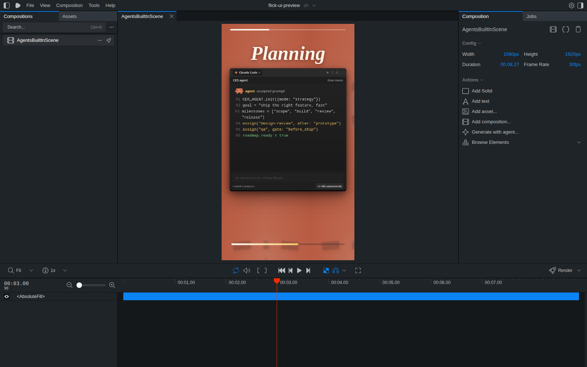
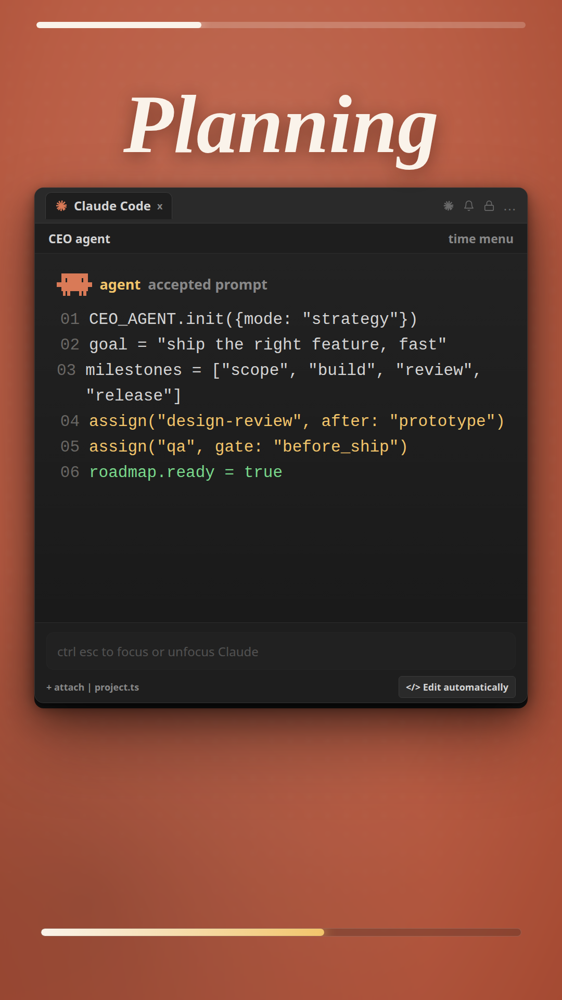

# Flick by Transformaiton.com

Flick turns a video, a public video link, or a script you paste into short animated scenes. A coding assistant follows the Flick skill, writes each scene in [Remotion](https://www.remotion.dev/), and opens the result for you to review.

Transformaiton.com publishes this guide for small-business owners who want explainer videos, social posts, and animated versions of a script. Transformaiton.com is an AI consultancy for small businesses. This repository is our public copy of the open-source Flick project.

[Install](docs/INSTALL.md) · [Use it](docs/USAGE.md) · [Examples](examples/) · [Contact](#contact)

## See it

Remotion Studio is the review screen Flick opens after it builds a scene. This picture was taken on 16 November 2026 from a local Studio session. The session loaded the Built-in agents scene that ships in this repository and paused at 00:03.00 (frame 90). Making the picture used a local render only. The window title shows a temporary preview folder, and that folder is not part of the repository.



The same scene, in motion. This GIF was made from [`examples/built-in-agents/AgentsBuiltInScene.mp4`](examples/built-in-agents/AgentsBuiltInScene.mp4), the example video already in the repository. That file’s metadata records Remotion 4.0.465.


One rendered frame from the same scene, produced locally with Remotion at frame 90. It matches the included example video at the three-second mark.



The original project preview is still in the repository at [`assets/flick-hero.gif`](assets/flick-hero.gif).

## What Flick does

1. You give it a video, a public link, or a pasted script.
2. A video or link becomes a timestamped transcript on your computer. A pasted script is used as the words.
3. Flick asks for the aspect ratio, the brand files to use, and your direction.
4. You approve a scene plan. Each part of the script becomes one named scene.
5. Flick builds those scenes, renders a video for each one, and opens Remotion Studio.
6. You ask for changes by scene name. When you are happy, you can save that scene as a reusable template.

Sound is limited to short effects that match an action on screen, such as a click, a reveal, or a transition. There is no music bed.

## Use cases

- **Explainer videos.** Turn a short script about your service into a vertical or landscape animation for your site, a proposal, or a customer email.
- **Social content.** Produce 9:16, 1:1, or 16:9 scenes for Instagram, TikTok, LinkedIn, YouTube Shorts, or a story.
- **A script you already have.** Paste the words and Flick animates them scene by scene. You can skip recording a video.
- **A talk you already recorded.** Point Flick at the file or a public link. It transcribes the audio on your computer, then plans scenes from that transcript.

You approve the plan before any scene is built. That is the moment to correct the story, the words on screen, and the files Flick may use.

## What you need, and what it costs

Flick has no subscription and no Flick API key. The MIT license covers this copy. The bills you may see come from the coding assistant you choose and, for a company with more than three people, from Remotion’s license. Both are charged by those vendors.

Prices below were read from the vendors’ public pages on 16 November 2026. They exclude tax, and they change. Open the linked page before you buy.

### Coding assistant

Flick is a skill your coding assistant follows. You need one of these products, signed in with that vendor’s account.

**Claude Code.** A paid Claude plan includes Claude Code and shares that plan’s usage limits. On the date above, [Claude’s pricing page](https://claude.com/pricing) listed Pro at $20 per month, or $17 per month when you pay $200 for the year. Max was $100 per month. Ultra was $200 per month. The Free plan is $0 and does not include Claude Code. If you use an Anthropic API key instead, billing is per token. On the [API pricing page](https://platform.claude.com/docs/en/about-claude/pricing) that day, Claude Sonnet 5.5 was $2 per million input tokens and $10 per million output tokens, and Claude Opus 5.5 was $4 and $20.

**Codex.** [Codex pricing](https://chatgpt.com/codex/pricing/) includes Codex in ChatGPT Free, Go, Plus, Pro, Business, and Enterprise, inside each plan’s usage limits. With an OpenAI API key, [OpenAI’s API pricing](https://developers.openai.com/api/docs/pricing) listed `gpt-5.3-codex` at $1.75 per million input tokens and $14 per million output tokens at standard speed.

**Cursor.** [Cursor pricing](https://cursor.com/pricing) listed Free at $0, Plus at $8 per month ($80 per year), Premium at $30 per month ($300 per year), Super at $100 per month ($1,000 per year), and Ultra at $200 per month ($2,000 per year). Team seats were $30, $100, or $200 per user per month. On Premium and above, third-party models are an extra charge at that model’s API price.

Gemini CLI, OpenCode, Cline, and Grok Build use the model account you connect in that tool. Use the vendor’s current pricing page for the rate.

A Flick job is one coding session. The assistant reads your script, writes the scene code, renders it, and revises the scenes you name. A short script uses less of your plan than a long video with several rounds of changes.

If `ANTHROPIC_API_KEY` is set on the computer, Claude Code bills the Anthropic API even when a Claude subscription is also available. Anthropic documents that behavior in its Claude Code help center.

### Transcription, download, and rendering

These steps run on your computer and do not use an API key.

| Piece | Cost |
| --- | --- |
| Whisper (`openai-whisper`) | Local speech-to-text. The package is OpenAI’s open-source model, running on your machine. Audio is not sent to the OpenAI API. The first transcription downloads the default `base` model. |
| yt-dlp | Used only for a public `http` or `https` link. It saves the audio on your machine. |
| FFmpeg | Bundled with the Remotion project through the `ffmpeg-static` package. |
| Remotion render | Local. This repository’s starter depends on Remotion 4 (`^4.0.0`). A first render can download a headless Chrome build. In the session that produced the pictures above, that download was about 100 MB. |

### Remotion’s license

Remotion’s published terms, checked on 16 November 2026 at [remotion.dev/docs/license/pricing](https://www.remotion.dev/docs/license/pricing):

- An individual, or a company of up to 3 people, can use Remotion for free, including commercial work.
- A larger company needs a Company License. Remotion for Creators is $25 per month per seat for people making videos in Remotion Studio or with a coding agent. Remotion for Automators is $0.01 per render, with a $100 per month minimum, for automated video products. Enterprise starts at $500 per month.

Confirm the terms that apply to your company on Remotion’s site. Transformaiton.com does not sell the Remotion license.

The full install checklist is in [docs/INSTALL.md](docs/INSTALL.md).

## Install

You need Node.js 20 or newer, Python 3.9 or newer, a network connection for the first setup, and one coding assistant from the section above.

**Claude Code**

```text
/plugin marketplace add Transformaiton/flick
/plugin install flick@flick
```

Then run `/flick`.

**Codex**

```text
npx skills add Transformaiton/flick --skill flick --agent codex --global --yes
```

Then ask: `Use $flick to animate this.`

**Cursor, Gemini CLI, OpenCode, Cline, Grok Build, and other compatible agents**

```text
npx skills add Transformaiton/flick --skill flick --global
```

Windows commands, the first-run setup, and updates are in [docs/INSTALL.md](docs/INSTALL.md).

## Quick start

1. Install Flick with one of the commands above.
2. Open your coding assistant in the project where you want the files.
3. Paste a script, or provide a video file or a public link.
4. Answer the three questions: aspect ratio, brand files, and what you want on screen.
5. Read `flick-plan.md` and approve it, or say what to change.
6. Watch the scenes in Remotion Studio. Ask for changes by scene name.
7. Collect the finished videos from `flick-output/scenes/`.

A sample script and the full walkthrough are in [docs/USAGE.md](docs/USAGE.md).

## What you receive

Each run uses one local folder. The default name is `flick-output/`. When that folder already exists, Flick creates `flick-output-YYYY-MM-DD-HHmmss/` instead.

```text
flick-output/
  transcript.json
  flick-plan.md
  remotion-brief.md
  scene-spec.json
  brand-assets/
  remotion/
  scenes/
    [approved-scene-name]/
      [approved-scene-name].mp4
      poster.jpg
```

`flick-plan.md` is the plan you approve. `remotion-brief.md` and `scene-spec.json` are the build instructions. Each approved scene is its own MP4, plus a poster image from a settled frame.

These folders stay on your machine. The repository ignores `flick-output/` by default.

## Examples

Six animations ship with this repository. The gallery is in [examples/](examples/).

| Example | What it shows |
| --- | --- |
| [Built-in agents](examples/built-in-agents/) | A product scene that introduces several agent roles. This is the scene in the pictures above. |
| [China OCR hook](examples/china-ocr-hook/) | A short hook about unlimited OCR. |
| [Claude token waste](examples/claude-token-waste/) | A hook about wasted tokens. |
| [Design systems constellation](examples/design-systems-constellation/) | Several tools merging into one. |
| [Gstack CEO install](examples/gstack-ceo-install/) | A product reveal that ends on an install command. |
| [Workflow start to finish](examples/workflow-start-to-finish/) | A handoff across three stages. |

## Troubleshooting and FAQ

**The assistant says Node.js 20 or newer is required.** Install Node.js 20 LTS or newer, then start the assistant again. On Windows the project suggests `winget install OpenJS.NodeJS.LTS`.

**The assistant says Python 3.9 or newer is required.** Install Python 3.9 or newer and make sure `python3` is on your PATH (`python` on Windows). On Windows the project suggests `winget install Python.Python.3.12`.

**The first run spends a long time downloading.** Setup installs Remotion, FFmpeg, Whisper, and yt-dlp from the network. The first video transcription also downloads the Whisper `base` model. Leave the connection up until the assistant says the workspace is ready.

**A public link fails with “yt-dlp did not create a WAV file.”** Give Flick a video file on your computer instead.

**“FFmpeg was not found” or “Whisper is not installed.”** The first-run setup has not finished. Follow [docs/INSTALL.md](docs/INSTALL.md).

**Studio never shares a link.** Flick shares the local Studio address only after `npm run studio` has started. Read the command output in the assistant’s reply.

**A scene needs a change.** Name the scene and describe the change. Flick revises that scene and renders it again.

**Can a pasted script skip transcription?** Yes. Pasting the words skips Whisper and yt-dlp. You still use the coding assistant’s own account.

**Where do the files go?** Into `flick-output/` in the project you started from. They stay on that computer.

Longer answers are in [docs/INSTALL.md](docs/INSTALL.md) and [docs/USAGE.md](docs/USAGE.md).

## Your material

Use video, images, fonts, audio, and brand files you have the right to use. Flick copies the brand files you select into the scene project. Workspaces stay on your computer.

## Credits

Flick was created by Creatorberry. The original repository is [https://github.com/Creatorberry/flick](https://github.com/Creatorberry/flick).

Transformaiton.com is not affiliated with or endorsed by the original authors.

Copyright (c) 2026 CreatorBerry. This copy remains under the MIT License. The copyright notice and permission text are in [LICENSE](LICENSE).

## Modifications by Transformaiton.com

This public copy changes the customer-facing documentation:

- This README
- [docs/INSTALL.md](docs/INSTALL.md)
- [docs/USAGE.md](docs/USAGE.md)
- [CONTRIBUTING.md](CONTRIBUTING.md)
- [.github/pull_request_template.md](.github/pull_request_template.md)
- The guide images in `docs/images/`

The skill instructions, scripts, Remotion starter, saved animations, example videos, and `LICENSE` are the upstream files. The skill and its step notes still include two prompts that link to the original project’s website. Those prompts are part of the upstream workflow and are unchanged in this copy.

## Contact

Transformaiton.com is an AI consultancy for small businesses.

- Website: [https://transformaiton.com/](https://transformaiton.com/)
- Email: [info@transformaiton.com](mailto:info@transformaiton.com)
- GitHub: [https://github.com/Transformaiton](https://github.com/Transformaiton)

Questions about this copy can go to that email. Questions about the original project belong with the [upstream repository](https://github.com/Creatorberry/flick).

## Contributing

See [CONTRIBUTING.md](CONTRIBUTING.md).

## License

MIT. Copyright (c) 2026 CreatorBerry. The full notice is in [LICENSE](LICENSE) and is unchanged.
