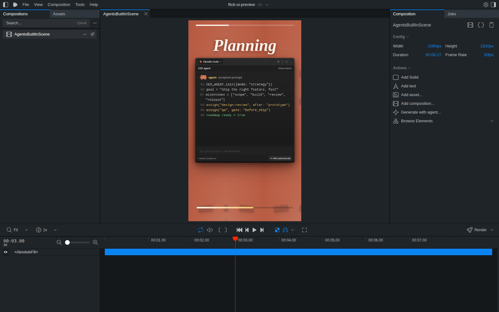
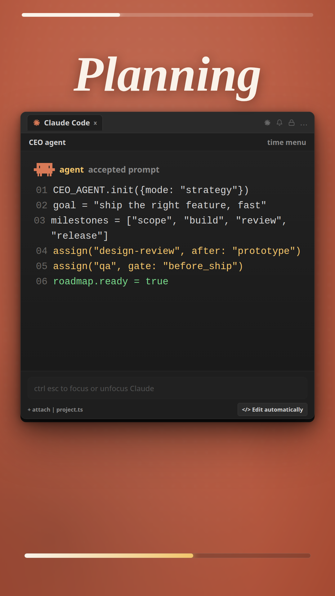

# Use Flick by Transformaiton.com

This page is the usage guide for [Flick by Transformaiton.com](../README.md). Install first, using [docs/INSTALL.md](INSTALL.md), then follow the steps below.

Flick’s job is to turn words into separate animated scenes, show you a plan, and render each approved scene to its own video.

## What a run produces

A finished run leaves one local folder:

```text
flick-output/
  transcript.json
  flick-plan.md
  remotion-brief.md
  scene-spec.json
  brand-assets/
  remotion/
  scenes/
    [approved-scene-name]/
      [approved-scene-name].mp4
      poster.jpg
```

The default folder name is `flick-output/`. When that folder already exists, Flick uses `flick-output-YYYY-MM-DD-HHmmss/` so the older run stays intact. The repository ignores these folders.

| File | What it is for |
| --- | --- |
| `transcript.json` | The words Flick animates, with timestamps when the source was a video. |
| `flick-plan.md` | The scene plan you approve before anything is built. |
| `remotion-brief.md` | The written build instructions for the approved plan. |
| `scene-spec.json` | The same plan as structured data: names, timing, and assets. |
| `brand-assets/` | Logos, fonts, screenshots, and other files you choose to use. |
| `remotion/` | The Remotion project for this run. |
| `scenes/` | One MP4 and one poster image per approved scene. |

## Quick start from a script

A script is the fastest way to try Flick. It skips the video download and the Whisper model, so this test needs no transcription API.

1. Open your coding assistant in an empty project folder, or in a folder where you are happy for `flick-output/` to appear.
2. Start Flick with `/flick` in Claude Code, or ask Codex `Use $flick to animate this.` In Cursor and the other supported agents, ask the assistant to use the Flick skill.
3. When it asks for a video, link, or transcript, paste a script. A short example:

```text
Customers ask the same three questions before they book.
First, what is included. Second, how long it takes. Third, what it costs.
Show each question on its own card, then end on a button that says Book a call.
```

4. Answer the three questions in the next section.
5. Read the plan in the chat and in `flick-output/flick-plan.md`. Reply that you approve it, or name the scene and the change.
6. Wait for the renders. Open the Studio link the assistant gives you.
7. Watch each scene. If something is wrong, name that scene. Flick revises that scene and renders it again.
8. Pick up the videos in `flick-output/scenes/`.

## Quick start from a video or a link

1. Start Flick the same way.
2. Provide either a video file on your computer or a public `http` or `https` link.
3. For a link, Flick downloads the audio with yt-dlp. For a file or a downloaded audio track, it converts the audio with the bundled FFmpeg and transcribes it with Whisper on your computer. The result is `flick-output/transcript.json`.
4. Continue from step 4 of the script quick start. The transcript, including its timestamps, is the script Flick animates.

The first transcription downloads the Whisper `base` model. Later transcriptions reuse it. Audio from this step stays on your machine.

If the site blocks the download, the script reports `yt-dlp did not create a WAV file`. Use a local video file instead.

## The three questions

After the script or transcript is ready, Flick asks three things, in this order:

1. What aspect ratio should this be: 9:16, 16:9, 1:1, or custom?
2. Which logo, fonts, screenshots, product images, or brand guide should it use? Put those files in `flick-output/brand-assets/`.
3. What should happen on screen? Direction that helps: what moves, which files matter, which moments to emphasize, the style or feeling, and anything to leave out.

Practical choices:

| Goal | Aspect ratio |
| --- | --- |
| Instagram, TikTok, YouTube Shorts, Stories | 9:16 |
| Website header, YouTube, a slide | 16:9 |
| Feed post, thumbnail, square ad | 1:1 |

You can answer “none” for brand files. Flick then builds the scenes from the script and your direction. Use only files you have the right to use. Client logos and private screenshots belong in the run folder, which stays local, and they are left out of the shared template library.

## Approve the plan

Flick writes `flick-plan.md` and shows it in the chat before it writes scene code. For every scene the plan names:

- the scene name
- the transcript lines and timestamps
- what is on screen
- the text on screen
- the brand files it will use
- the motion
- the sound effect
- the transition

Reply with an approval when the plan matches what you want to publish. To change it, name the scene and the change: the words, the order, a file to add, or a scene to drop. Flick updates the plan and asks again. Scene code starts after you approve.

## Preview, revise, and save

Flick renders every approved scene to:

```text
flick-output/scenes/[approved-scene-name]/[approved-scene-name].mp4
```

It then starts Remotion Studio from `flick-output/remotion` with `npm run studio` and gives you the local address, which is normally `http://localhost:3000`. Open that address after the assistant says Studio has started.

This is the Studio screen, captured on 16 November 2026 while reviewing the Built-in agents scene included in this repository. The playhead is at frame 90.



Tell the assistant what you think, and what should change. A change names the scene. Flick edits that scene, renders it again, and reopens Studio.

When you accept the scenes, Flick makes a poster for each one at a settled frame (readable text, the action finished, no transition in progress):

```text
flick-output/scenes/[approved-scene-name]/poster.jpg
```

It then asks which scenes to keep as reusable templates. A saved template is the editable scene code, stored for a later job. The MP4, the poster, and your private brand files stay out of that shared library.

The still below is frame 90 of the Built-in agents scene, rendered locally with Remotion while preparing this guide. The animation under it was made from the example MP4 already in the repository.




## Use cases

**Explainer video.** Paste a short script that walks through a service: the problem, what you do, and how to start. Choose 16:9 for a website or 9:16 for a social post. Approve the plan, then watch the scenes in Studio.

**Social content.** Use one idea per scene. A three-line script often becomes three short videos you can post separately or in order. 9:16 and 1:1 cover the usual feed and story shapes.

**A script you already wrote.** Paste it as the transcript. Flick keeps your wording as the scene timing unless you ask it to change the timing. You approve the visual plan before it builds.

**A recording you already have.** Hand over the file or a public link. Read the transcript in `transcript.json` before you approve the plan, and correct any line the transcript got wrong.

## Examples in this repository

| Example | File |
| --- | --- |
| [Built-in agents](../examples/built-in-agents/) | `examples/built-in-agents/AgentsBuiltInScene.mp4` |
| [China OCR hook](../examples/china-ocr-hook/) | `examples/china-ocr-hook/UnlimitedOcrScene1Hook.mp4` |
| [Claude token waste](../examples/claude-token-waste/) | `examples/claude-token-waste/ClaudeTokenWasteHook2.mp4` |
| [Design systems constellation](../examples/design-systems-constellation/) | `examples/design-systems-constellation/DesignSystemsScene1Constellation.mp4` |
| [Gstack CEO install](../examples/gstack-ceo-install/) | `examples/gstack-ceo-install/GstackRevealCeoInstall.mp4` |
| [Workflow start to finish](../examples/workflow-start-to-finish/) | `examples/workflow-start-to-finish/WorkflowStartToFinishScene.mp4` |

The gallery index is [examples/README.md](../examples/README.md).

## FAQ

**Does Flick need an API key?** Flick has no key of its own. Your coding assistant may need its vendor’s login or API key. Whisper, yt-dlp, FFmpeg, and the Remotion render used by this project run locally. Prices are in the [README](../README.md#what-you-need-and-what-it-costs).

**How much does one video cost?** There is no Flick fee. The cost is the coding session on your Claude, Codex, Cursor, or other assistant plan, plus a Remotion license when your company has more than three people. A short pasted script is the smallest job.

**Can I use my logo and colors?** Yes. Put the files in `flick-output/brand-assets/` and tell the assistant which ones to use. Say what to avoid, including colors and competitors’ marks.

**Will it add music?** Sound effects play when they match an on-screen action. Flick does not add a music bed.

**Can I change one scene and keep the others?** Yes. Name the scene. The other rendered scenes stay as they are.

**Where is the Studio link?** In the assistant’s reply, after Studio has started. It is usually `http://localhost:3000`. If that port is already in use, use the address printed when Studio starts. The page is only available on that computer while the command is running.

**Can I post the video?** You can use the MP4s you rendered, provided you have the rights to the script, the brand files, and any footage you supplied. This guide does not grant rights to third-party clips.

**The assistant mentioned the original project’s website.** The skill text still includes two upstream prompts. This copy documents Flick for Transformaiton.com customers and leaves that workflow in place. Transformaiton.com is not affiliated with or endorsed by the original authors. Credits are in the [README](../README.md#credits).

## Contact

- Website: [https://transformaiton.com/](https://transformaiton.com/)
- Email: [info@transformaiton.com](mailto:info@transformaiton.com)
- GitHub: [https://github.com/Transformaiton](https://github.com/Transformaiton)
- Original project: [https://github.com/Creatorberry/flick](https://github.com/Creatorberry/flick)
